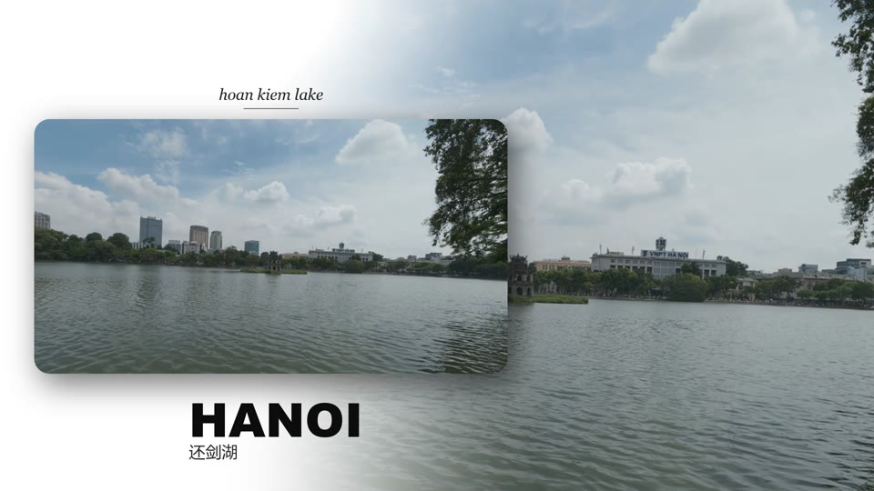
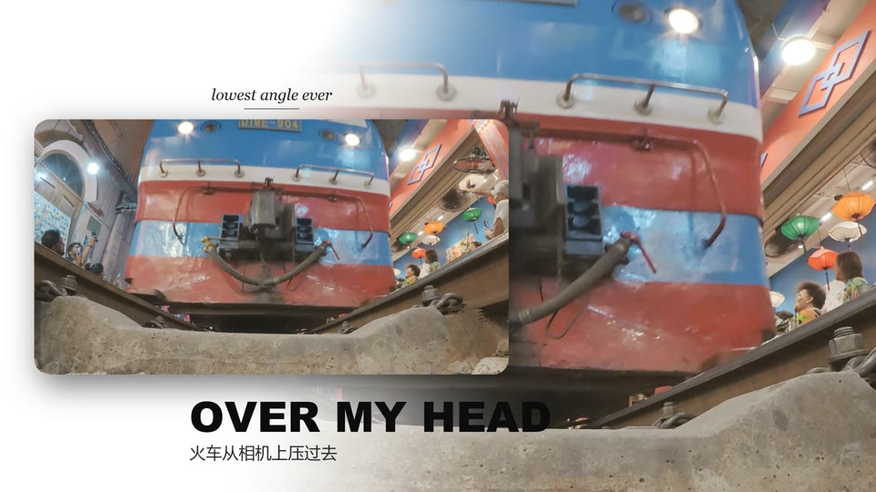
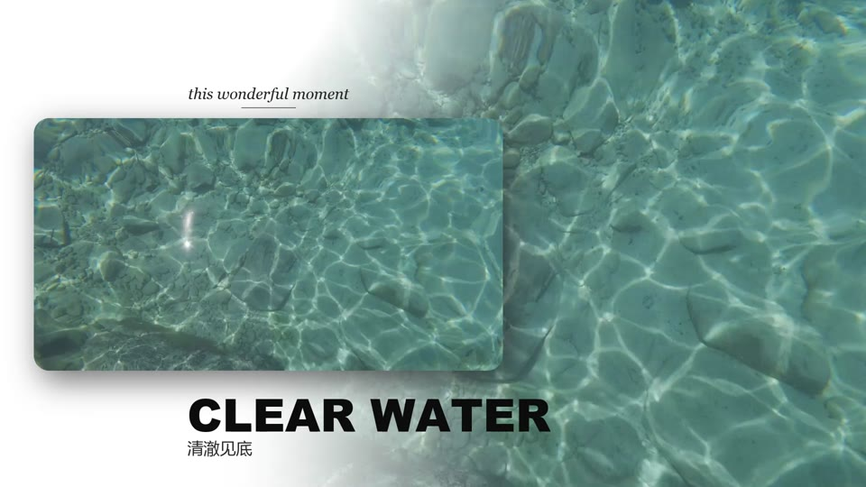
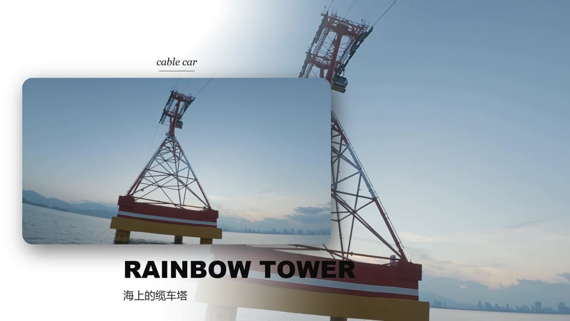
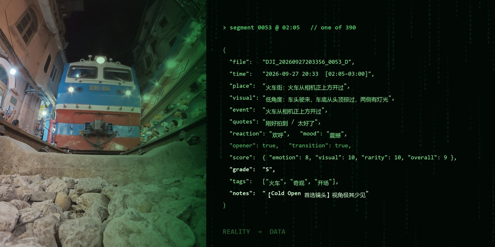
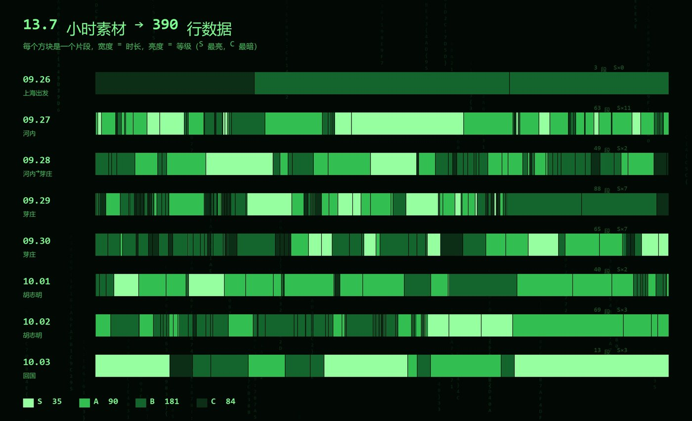

**中文** · [English](README.en.md)

# vlog-director · Vlog 导演

**几百 G 旅行素材剪不动？交给 Claude，它当导演、剪辑师和素材管理员，你只负责审片。**

一个 [Claude Code](https://claude.com/claude-code) 的 skill。把一文件夹原始视频交给它，它会先把每段视频「看」成表里的一行，再按表剪成带字幕的 vlog，或者卡在音乐小节上的杂志卡片风混剪。


<sub>上面这段出自一支 1 分钟混剪：6 天旅行、358 段素材、13.7 小时，镜头、卡片、标题、卡点全部由 skill 完成。</sub>

## 快速开始

```bash
git clone https://github.com/quangtoanhoang767-ux/vlog-director ~/.claude/skills/vlog-director
```

打开 Claude Code，说一句：

> 帮我把 D:\旅行素材 剪成 vlog

它会问你几个问题（素材在哪、几个人、想要长片还是混剪），然后一步步带你走到出片。依赖（Python 包、ffmpeg、开源字体）它会自己装。

## 作品墙

全部出自同一支混剪，每张都是 skill 自动排版的一个镜头：

| | |
| --- | --- |
|  |  |
| 卡片从侧边滑入，背景放大铺白雾 | 大标题自动缩放到放得下，中文副标题 |
|  |  |
| 音乐 drop 那一下：白闪 + 2 小节重点镜头 | 卡片左右交替，节奏更跳 |
|  |  |
| 小字用英文斜体，大标题用粗黑体 | 收尾镜头，之后画面淡成白纸、浮出宋体片尾 |

剪片之前，它先把所有素材整理成一张表。左边是画面，右边是它在表里的样子：



整趟旅行 390 个片段按时间排开，越亮越值得用。哪天最精彩、哪段必须用，一眼就能看出来：



## 它能做什么

- **长片**：几分钟到十几分钟，有故事、有对白字幕。配乐只有两档固定音量：有人说话时低，没人说话才升高，不会忽大忽小。
- **混剪**：1 到 2 分钟的杂志卡片风快剪。切点全部卡在音乐小节上，片头是白纸上显影的宋体片名，可以加一条航线、每两拍点亮一站；片尾接着最后一个镜头淡成白纸。
- **素材表**：每段视频一行，时间、地点、人物、原话、好不好笑、能不能当开头，打 S/A/B/C 分，导出成 Excel 能打开的表。以后想找「那个镜头」，查表就行。
- **顺手的**：朋友圈截图、封面、每个人一支个人小片。

## 安装

三种方式任选，最后都是把 `vlog-director` 文件夹放进 Claude Code 的 skills 目录：

- **git**：上面快速开始那行命令。
- **下载 zip**：点 GitHub 页面的 Code → Download ZIP，解压后放进去：
  - macOS / Linux：`~/.claude/skills/vlog-director/`
  - Windows：`C:\Users\<你的用户名>\.claude\skills\vlog-director\`
- **只装给某个项目**：放进项目里的 `.claude/skills/vlog-director/`。

## 用法

开工：

> 帮我把 D:\旅行素材 剪成 vlog
>
> 这是我们四个人去日本 5 天拍的，帮我剪一支 10 分钟左右的长片

审片时说感受就行，不用懂剪辑：

> 太长了，砍到 8 分钟
>
> 开头和正片重复了
>
> 音乐别比人声大
>
> BGM 时大时小
>
> 再剪一支 2 分钟的炫酷混剪，音乐全程覆盖

找镜头：

> 烤鳄鱼那个镜头在哪
>
> 把所有能当开头的镜头列出来

几个习惯会让结果好很多：

- **素材多的话，先拿 3 到 5 段跑通**整个流程，再放开全部。
- **认人那一步认真答**。它会截出每个人的画面问你谁是谁，答错了后面全错。
- **想要的镜头直接点名**：「海边挥帽子那个必须有」，它会去表里找。

## 它是怎么工作的

核心只有一句：**先建表，再剪。**

AI 没法把 13 小时视频从头看到尾，所以它把「看」拆成两件事：**听**（本地 Whisper 转写，每句带时间戳，顺便记音量，音量突增的地方多半是笑点）和**看**（每 3 秒抽一帧拼成大图）。然后把每段素材写成表里的一行。之后选镜头、写故事、找台词，全都变成查表。

整个流程分 7 步，每一步做完都会停下来汇报，等你点头再继续：

1. **准备**：问清素材在哪、拍的是什么、要什么片子，检查电脑配置，估算要多久。
2. **处理素材**：生成低清副本、语音转写、抽帧拼图。最慢的一步，可以断点续跑。
3. **认人**：截出每个人清楚出镜的画面，请你告诉它谁是谁。
4. **建表**：每段写一行、打分，导出 Excel。
5. **故事方案**：主线、每个人的高光、笑点、伏笔和呼应、开头结尾候选。
6. **剪辑**：写剪辑表（每行最后一栏是「为什么用这个镜头」），出片，抽帧自检。
7. **审片**：按你的意见改，每版存新版本号，不覆盖旧的。

几条写死的规矩：

- **原片只读**。任何脚本、任何时候都不在原片目录里写、改、删。
- **不编造**。转写会听错、会幻听，认人会认错。不确定的标「待确认」来问你，关键台词上字幕前会重新核实。
- **配乐永远比人声小**。

细节在 [`SKILL.md`](SKILL.md) 和 [`references/`](references/)：表格字段、打分标准、故事怎么排、混剪怎么编、你的大白话对应什么改法，以及踩过的坑。

## 要求和局限

- **Claude Code**，加上 **Python 3.10+**。
- **一块 N 卡**（强烈建议）。语音转写约为素材时长的 1/10；没有显卡也能跑，慢几倍、准确率略低。
- **硬盘空间**：大约原片体积的 10%。
- **出片时间**（RTX 级显卡实测）：12 分钟长片第一次渲染约半小时，之后改剪辑表只重渲改动的镜头；2 分钟混剪约 12 分钟。
- **配乐是短板**。没指定歌时会用代码现场合成一段无版权配乐（长片是轻快的木吉他，混剪是 140 BPM 电子乐），够用，但听得出是「做出来的」。想要更好的效果，换一首你喜欢的歌。
- **不是一键生成**。好不好看、好不好笑还得你拍板，它最强的是记性。

## 隐私

原片不会离开你的电脑，语音转写和渲染也都在本地跑。但 Claude 要「看」素材，会读取抽帧截图和对白文字，这些内容会发送给 Claude。介意的话请先想清楚。

认人表和人名只留在你本地的工作目录里，不会写进任何要公开的东西。

## 字体

优先用系统字体；没有的会自动下载 Google Fonts 上的开源字体（思源黑体、思源宋体、Archivo Black、Libre Baskerville、龙藏体手写、Noto Symbols 2），都是 SIL Open Font License，可免费商用。想换成自己的字体，在 `project.json` 的 `fonts` 里指定路径。

## 参与

用它剪出了片子，欢迎在 Issues 里晒一下；遇到问题或者有新的坑，也请提 issue 或者 PR。

## 许可证

MIT
